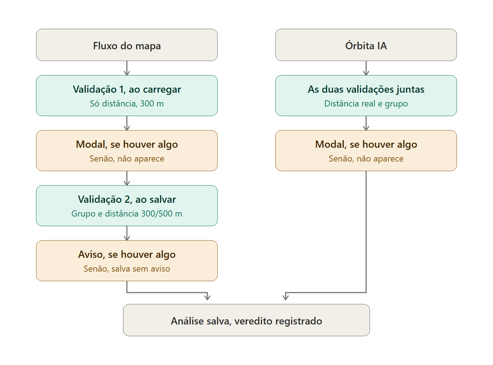

Regra para descrever como o Órbita passa a validar o zoneamento de um ponto, em duas etapas da análise, usando uma base de lojas sincronizada do Radar em D-1 somada às bases de contratos de expansão e de análises de ponto.

## Contexto

Hoje a consulta de zoneamento é manual. O analista precisa saber que a regra existe, onde ela está e como se conta — faixa de população, quem ocupa vaga, qual distância vale. Isso faz com que a consulta role tarde, depois de a análise de mercado já ter sido feita, ou não role; que cada pessoa aplique a regra de um jeito; e que não fique rastro de quem decidiu o quê. O que acarreta em diversos momentos nos quais a regra acaba por ser ferida.

### Problema(s) e dor(es) que precisamos resolver

- Trazer a consulta de zoneamento para dentro do Órbita, sem depender do conhecimento prévio do analista;
- Avisar o analista que um ponto fere o zoneamento no começo da análise, e no fim;
- Explicar sempre o motivo de o ponto ferir o zoneamento, e não só informar que feriu;
- Contar lojas, grupos econômicos e distâncias sobre uma base atualizada, no lugar da contagem manual;
- Considerar contratos de expansão fechados e análises de ponto aprovadas na contagem, não só lojas já cadastradas.

## Objetivos do usuário

- Saber, ao carregar o ponto, se ele fere a distância mínima entre lojas;
- Entender por que o ponto fere o zoneamento;
- Ser avisado, ao salvar a análise, quando o ponto fere o zoneamento;
- Não gastar análise de mercado em ponto que a regra barra.

## Fluxograma

## Regras de negócio

- **Base de lojas sincronizada do Radar**
    - A base de lojas do Órbita passa a ser atualizada diariamente, em D-1, a partir do cadastro do Radar;
    - A carga precisa trazer, por loja:
        - CNPJ, nome e razão social;
        - Endereço da Receita, com município, UF, latitude e longitude;
        - Endereço popular, com município, UF, latitude e longitude;
        - Status;
        - Bandeira;
        - Modelo de negócio (Popular ou Convencional);
        - Grupo econômico, como identificador próprio;
        - Responsável pelo grupo econômico.
    - Se a carga falhar, o Órbita opera com a última carga bem-sucedida; acima do limite de defasagem, o resultado é indeterminado, não liberado;
    - Loja sem coordenada utilizável entra na contagem do município, mas não pode ser checada na distância;
- **Validação 1 — ao carregar o ponto**
    - Vale para o fluxo normal do mapa;
    - Ao carregar o ponto, o Órbita checa apenas a distância entre lojas;
    - Nessa etapa é usado o limiar único de 300 metros, independentemente da bandeira;
    - Se o ponto ferir a distância, deve aparecer um modal em tela avisando que o ponto fere o zoneamento, com o motivo;
    - O analista pode seguir com a análise depois de confirmar.
- **Validação 2 — ao salvar a análise**
    - Ao salvar, o Órbita roda a validação de grupo econômico naquela cidade;
    - Roda também a regra de zoneamento completa, incluindo a distância entre lojas com os limiares reais (300 metros para a mesma bandeira e 500 metros para bandeira diferente);
    - O aviso só aparece quando há algo a apontar: se o ponto ferir o zoneamento ou se houver avisos, dizendo que estaria bloqueado e por quê;
    - Quando não há violação nem aviso, a análise é salva sem aviso em tela;
    - O veredito fica registrado junto da análise mesmo quando não há aviso, com os números que o sustentam e a data da carga do Radar.
- **Análise feita pelo Órbita IA**
    - Na análise feita pela IA as duas validações rodam ao mesmo tempo, quando a tela final é montada;
    - Nesse momento valem os limiares reais de distância — 300 metros para a mesma bandeira e 500 metros para bandeira diferente — junto da validação de grupo econômico da cidade;
    - A triagem de 300 metros do fluxo do mapa não se aplica aqui, porque não existe etapa de carregar o ponto;
    - O modal só aparece quando há algo a apontar: se o ponto ferir o zoneamento ou se houver avisos;
    - Quando não há violação nem aviso, nenhum modal é exibido e a tela final é entregue normalmente;
    - O modal traz a mesma explicação exigida nas demais validações;
    - O veredito fica registrado junto da análise mesmo quando não há modal, como no fluxo do mapa.
- **Conteúdo obrigatório do aviso**
    - Nenhum aviso pode dizer apenas que o ponto fere o zoneamento;
    - Em qualquer uma das validações, o texto precisa trazer:
        - Qual regra foi ferida e qual limiar foi aplicado;
        - Contra o quê — a loja (bandeira, bairro ou endereço, status, distância medida e se é do próprio solicitante) ou a contagem (quantos grupos econômicos e qual o teto da cidade);
        - Contra qual endereço da loja, o da Receita ou o popular;
    - Nome de pessoa não aparece em tela; os grupos econômicos aparecem com rótulo anônimo, estável dentro do município;
- **Teto de lojas por cidade**
    - O teto é contado por município;
    - O teto conta grupos econômicos, não lojas;
    - As faixas são:
        - Até 60.000 habitantes: 1 grupo econômico, sem expansão adicional;
        - De 60.001 a 120.000: até 2 grupos, e o segundo grupo entra com bandeira popular;
        - De 120.001 a 200.000: até 3 grupos, com alternância de bandeiras;
        - Acima de 200.000: sem teto, ocupação decidida por market share.
    - Os cortes são fechados em 60.000, 120.000 e 200.000 habitantes;
    - A contagem considera o cenário depois do pedido: o pedido sempre soma uma loja, e soma um grupo econômico apenas quando o solicitante ainda não responde por loja, contrato ou análise aprovada naquele município;
    - Ser associado em outro município não dá vaga; estar naquela cidade, sim;
    - Quando a cidade, com o pedido, passar a ter mais lojas do que o número da faixa, o Órbita avisa, mas isso não bloqueia;
- **Quem ocupa vaga na contagem**
    - Lojas com status Ativado, Montando ou Transição ocupam vaga;
    - Lojas com status Desativado não ocupam vaga;
    - Contrato de expansão assinado e vigente ocupa vaga;
    - Análise de ponto aprovada ocupa vaga;
    - Contrato cancelado ou distratado deixa de ocupar vaga imediatamente, e o evento de distrato precisa chegar ao Órbita;
    - Um mesmo ponto que percorreu análise, contrato e loja não pode ser contado três vezes, o ponto conta uma única vez, pela origem mais avançada — loja, depois contrato, depois análise;
- **Distância mínima entre lojas**
    - A distância mínima é de 300 metros entre lojas da mesma bandeira e 500 metros entre lojas de bandeiras diferentes;
    - A distância é medida por coordenada, independentemente do município cadastrado da loja — ponto em divisa de cidade também é avaliado;
    - Em cidades acima de 200.000 habitantes a página oficial não declara distância mínima, então o descumprimento vira aviso;
    - Se a bandeira pretendida não for informada, aplica-se o critério mais restritivo, de 500 metros;
- **Dois endereços por loja**
    - Toda loja tem endereço da Receita e endereço popular, e eles podem divergir;
    - A distância é avaliada pelos dois pontos, e vale a menor distância encontrada: basta um dos dois ferir para a regra estar ferida;
    - A loja ocupa vaga no município de cada um dos dois endereços; se os endereços estiverem em municípios diferentes, ela ocupa vaga nos dois;
    - O aviso diz contra qual dos dois endereços a violação ocorreu;
- **Grupo econômico**
    - O grupo econômico é apurado pelo identificador próprio do cadastro do Radar, não pelo nome do responsável;
- **Bandeira e modelo de negócio**
    - Na faixa de 60.001 a 120.000 habitantes, o grupo que entra como segundo da cidade deve abrir com bandeira de modelo Popular;
    - Se o pedido traz o segundo grupo e o modelo é Convencional, o ponto fere o zoneamento;
    - Se o pedido é de loja adicional de um grupo que já está na cidade, isso não bloqueia e vira aviso;
    - Se o modelo de negócio não for informado no pedido, a regra é declarada como não avaliada — nunca tratada como se tivesse passado;
    - Na faixa de 120.001 a 200.000, se a cidade já tiver loja da bandeira pretendida, o Órbita avisa, sem bloquear;
    - Acima de 200.000 habitantes não há teto, e o Órbita avisa que a ocupação é decidida por market share.
- **Perfil do solicitante**
    - O perfil é pergunta obrigatória no início da análise: empresário novo ou empresário que já opera loja Farmarcas;
    - Sobreposição com loja do próprio solicitante e sobreposição com loja de outro associado são itens distintos e nunca aparecem juntos:
        - Com loja do próprio solicitante, é efeito econômico a dimensionar, e pode ser uma escolha dele;
        - Com loja de outro associado, é conflito de interesse entre associados, que é o que a regra existe para evitar.

## Figma

A ser construído.
